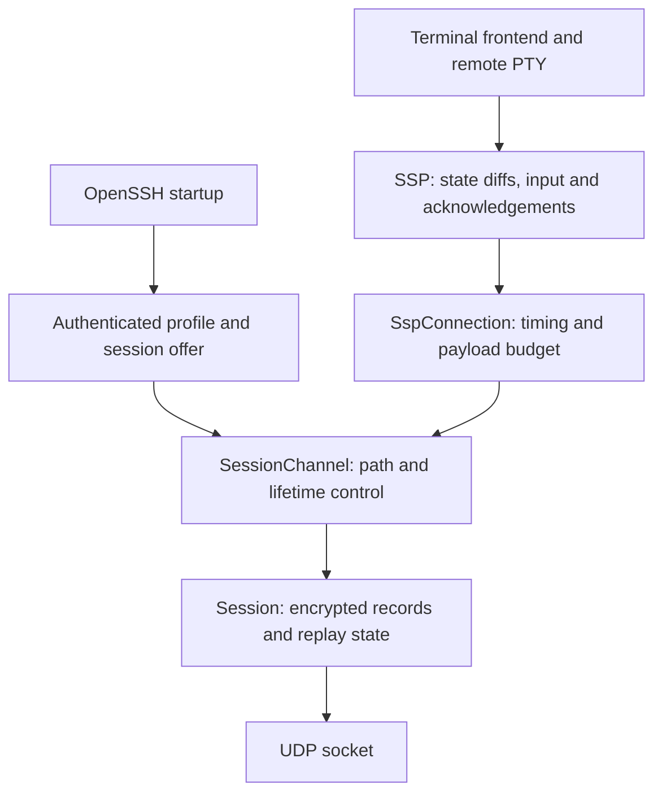

# Architecture and project boundaries

[Documentation index](README.md) · [Current roadmap](integration.md)

Phantom Mosh retains Mosh's terminal state engine and adds an experimental
transport, authenticated startup and a separate Linux terminal frontend.
This guide describes the implementation on the default branch. Proposed
transport work is labelled separately below.

## Current data path

The client and server each run the corresponding side of this stack. SSH is
used for authenticated startup; the ongoing terminal session travels over UDP.

| Layer | Responsibility | Source |
| --- | --- | --- |
| Terminal frontend | Local input/display, remote PTY, resize, terminal modes and authenticated exit status | [`terminal_client.cc`](../../src/phantom/terminal_client.cc), [`terminal_server.cc`](../../src/phantom/terminal_server.cc), [`terminal_state.h`](../../src/phantom/terminal_state.h) |
| SSP | State diffs, compression, fragmentation, state acknowledgements, retransmission and convergence | [`ssp_transport.h`](../../src/phantom/ssp_transport.h), inherited [`networktransport.h`](../../src/network/networktransport.h) |
| Connection adapter | SSP's monotonic clock, timing samples, datagram budget and service scheduling | [`ssp_connection.h`](../../src/phantom/ssp_connection.h), [`ssp_timing.h`](../../src/phantom/ssp_timing.h) |
| Session channel | Socket and record-session ownership, bounded receive batches, path validation, retry and close deadlines | [`session_channel.h`](../../src/phantom/session_channel.h) |
| Record layer | Directional keys, protected packet numbers, encrypted epoch acknowledgements, key transitions and replay protection | [`record.h`](../../src/phantom/record.h), [`record.cc`](../../src/phantom/record.cc) |
| Bootstrap | Existing SSH host trust, exact profile selection, bounded offer parsing and secret handoff | [`ssh_startup.h`](../../src/phantom/ssh_startup.h), [`session_offer.h`](../../src/phantom/session_offer.h) |

The channel carries application datagrams. It does not provide SSP, application
retransmission, fragmentation or terminal I/O itself. A successful local send is
not proof of peer receipt. SSP remains responsible for convergence and input
delivery above that boundary.

The current encrypted UDP record is capped at 1200 bytes. Record, session,
timing and fragment overhead are all charged against that budget; the adapter
does not give the state engine the full 1200 bytes as application payload.
The [SSP reference](ssp.md) gives the exact accounting.

## Ownership and recovery

Each endpoint has one live process owning its keys, counters, replay history and socket.
The channel can replace a client socket or revalidate a changed source port
while preserving that state. Initial connection deadlines and established
session recovery are different: the default established-route recovery policy
has no expiry, while retry intervals back off to a configured cap.

The frontend preserves terminal state during a network outage and waits for
the path to recover. It does not reconstruct a session after process failure.
A crash, reboot or snapshot restore requires fresh authenticated startup;
live cryptographic state must not be copied into a second sender. No persistent
reattachment, VM-restore or restart-resume contract is implemented.

The remote server endpoint is fixed for the session. Client source-port recovery
does not imply server-address migration, cross-address-family migration or a
UDP tunnel through an SSH jump host. See [terminal recovery](terminal-recovery.md)
for what the loopback tests actually cover.

The server owns its PTY and ordinary shell descendants, with bounded userspace
cleanup. It is not a hostile-process sandbox. The [terminal reference](terminal-integration.md)
describes the Linux process facilities, inherited environment and cleanup limits.

## Compatibility

These names describe different layers; they are not interchangeable version
numbers for a single executable.

| Surface | Identifier or executable | Meaning |
| --- | --- | --- |
| Inherited runtime | `mosh`, `mosh-client`, `mosh-server` | Upstream Mosh v2 code path |
| Phantom record format | `phantom-mosh/v3/draft-01` | Experimental encrypted record profile |
| Diagnostic application | `phantom-mosh/session/draft-01` | Control-only server/probe startup, confirmation and close |
| Terminal application | `phantom-mosh/terminal/draft-02` | SSH-to-PTY terminal with authenticated exit-status state |

The terminal draft-02 application uses the existing record draft-01 layer.
Exact application-profile selection is bound to SSH startup. The diagnostic
probe does not start a terminal, terminal and diagnostic offers are rejected
across profiles, and old terminal profiles do not silently downgrade.
There is no `--protocol=v3` switch on the inherited binaries.

The record layer uses OpenSSL primitives; the record composition, header
protection and acknowledgement-gated key-update state machine are project
designs. Symmetric key rotation does not provide post-compromise recovery.
See the [security notes](security.md) for the assumptions and review limits.

## Transport comparison direction

**Planned, not implemented:** make the application/transport contract explicit
enough to compare the current custom backend with QUIC DATAGRAM while retaining
the terminal frontend, SSP semantics and acceptance fixtures. The existing
connection-backend parameter is a starting point, not a completed backend plugin
API; `SspTransport` currently constructs the Phantom connection implementation.

[QUIC DATAGRAM (RFC 9221)](https://www.rfc-editor.org/rfc/rfc9221.html) carries
unreliable application datagrams within a QUIC connection and subjects them to
QUIC congestion control. That makes it a candidate for an SSP comparison.
[QUIC (RFC 9000)](https://www.rfc-editor.org/rfc/rfc9000.html) also defines
connection migration and idle-timeout behaviour that must be evaluated against
Phantom's long-outage expectations.

The experiment must specify authentication and identity binding, effective
payload limits, loss/backpressure semantics, scheduling, connection lifetime,
path changes and orderly shutdown. Preserving terminal behaviour across a new
connection is a separate application design problem. A standards-based transport
does not establish application security, long-outage equivalence or resistance
to traffic classification by itself.

The decision should follow matched terminal, recovery, resource-use and network
measurements. The current custom transport remains the implemented research
baseline. Neither backend is declared the winner in advance, and no protocol
or security-profile change is made by this documentation.

## Evidence boundaries

Component tests, independent reference encoders, sanitizers, real OpenSSH/PTY
fixtures and retained loopback observations answer different questions. They
support bounded implementation claims, not a blanket security or network claim.
The [documentation index](README.md#dated-evidence) separates current references
from dated reports, and the [roadmap](integration.md) states remaining work.
